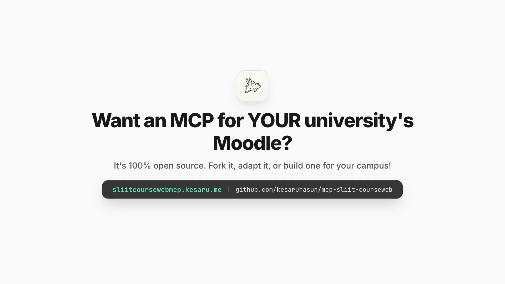
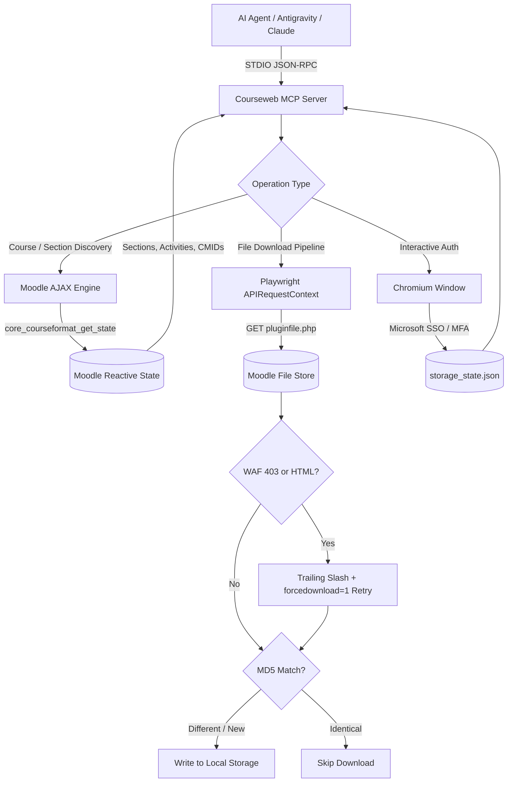
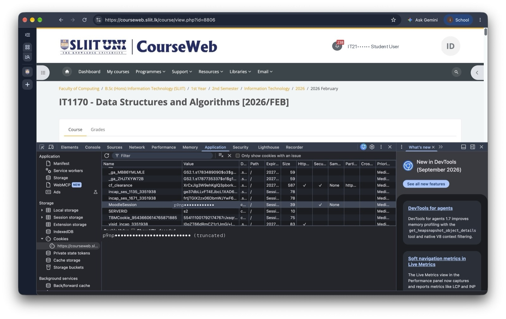
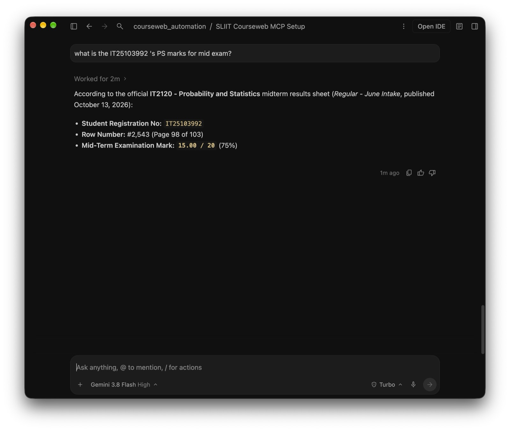
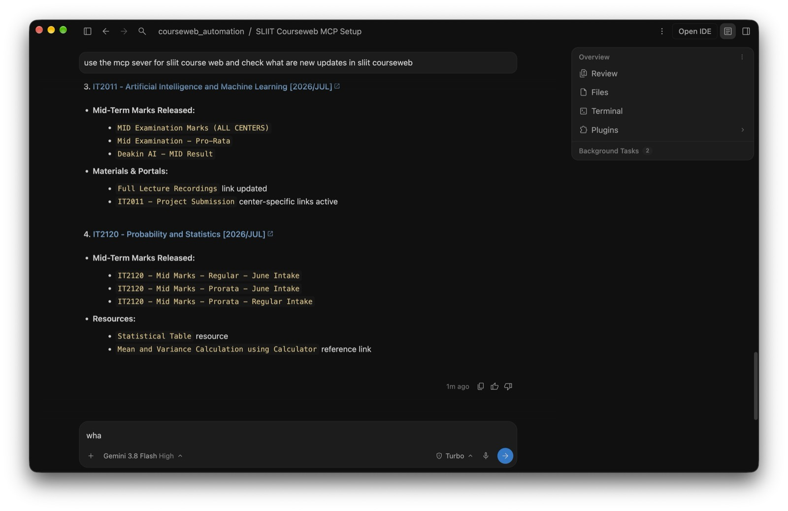

<p align="center">
  <a href="https://sliitcoursewebmcp.kesaru.me" target="_blank" rel="noopener noreferrer">
    
  </a>
</p>

<h1 align="center">SLIIT Courseweb MCP Server</h1>

<p align="center">
  High-performance Model Context Protocol engine connecting AI agents to SLIIT Courseweb (Moodle) for autonomous material synchronization, exam marksheet extraction, and deadline tracking.
</p>

<p align="center">
  <a href="https://www.typescriptlang.org"></a>
  <a href="https://modelcontextprotocol.io"></a>
  <a href="https://nodejs.org"></a>
  <a href="https://sliitcoursewebmcp.kesaru.me"></a>
  <a href="LICENSE"></a>
</p>

<p align="center">
  <a href="#overview">Overview</a> &bull;
  <a href="#video-showcase">Showcase</a> &bull;
  <a href="#architecture--modes">Architecture</a> &bull;
  <a href="#project-structure">Structure</a> &bull;
  <a href="#installation">Installation</a> &bull;
  <a href="#tool-reference">Tools</a> &bull;
  <a href="#academic-superpowers">Superpowers</a> &bull;
  <a href="#security--fair-use">Security</a> &bull;
  <a href="#license">License</a>
</p>

## Overview

SLIIT Courseweb is the central academic portal for lecture presentations, tutorial sheets, and assessment submissions. During peak academic weeks and exam periods, students encounter recurring bottlenecks: portal latency before submission deadlines, searching through massive 100+ page exam marksheet PDFs, and manually downloading dozens of lecture files week after week.

The SLIIT Courseweb MCP Server bridges these workflows directly into AI coding assistants (Google Antigravity, Claude Code CLI, Cursor, Windsurf, and OpenAI Codex) via the open standard Model Context Protocol.

Version 1.2.0 introduces native integration with Moodle 4.x JSON-RPC web services (`core_courseformat_get_state` and `core_course_get_enrolled_courses_by_timeline_classification`). This bypasses frontend DOM scraping to deliver sub-second course discovery, native support for modern card layout formats (`format_tiles` and `format_grid`), recursive `mod_folder` extraction, and automated MD5 delta file downloads.

## Video Showcase

Watch Claude Code autonomously parse a 103-page PDF exam marksheet, extract student marks, and delta-sync lecture presentations in seconds:

<div align="center">
  <video src="assets/courseweb-launch-preview.mp4" poster="assets/courseweb-launch-poster.jpg" width="100%" controls playsinline>
    <a href="https://raw.githubusercontent.com/kesaruhasun/mcp-sliit-courseweb/main/assets/courseweb-launch-preview.mp4">
      
    </a>
  </video>
  <p align="center">
    <a href="https://raw.githubusercontent.com/kesaruhasun/mcp-sliit-courseweb/main/assets/courseweb-launch-preview.mp4">Watch 20-Second Video Preview (600 KB MP4)</a> &bull; 
    <a href="https://sliitcoursewebmcp.kesaru.me/#video-demo">Stream 1080p on Live Portal</a>
  </p>
</div>

## Architecture & Modes

The server employs a dual-engine architecture that routes state queries through fast JSON-RPC endpoints while executing file downloads through authenticated binary streams protected by automated WAF fallback handlers.

| Capability | Native Moodle JSON-RPC Engine (v1.2.0) | Legacy Headless DOM Scraping |
| :--- | :--- | :--- |
| **Inspection Latency** | Sub-300ms direct RPC payload | 8,000ms - 15,000ms page navigation |
| **Dynamic Tiles Support** | Complete section and activity discovery | Incomplete (Sections 1-12 rendered as hidden empty containers) |
| **Resource Footprint** | Lightweight HTTP POST stream (~15 MB RAM) | Full headless Chromium DOM tree (~250 MB RAM) |
| **Folder Unpacking** | Recursive `mod_folder` file discovery | Requires manual subfolder navigations |
| **WAF Resilience** | Automatic Incapsula token propagation + trailing-slash retry | Intercepted by Cloudflare / Imperva challenges |
| **Course Discovery** | Server-side timeline classification (starred, active, past) | Fragmented across multiple paginated dashboard views |



## Project Structure

```
.
├── src/
│   ├── index.ts              # MCP STDIO server entrypoint, schema validation, and tool dispatch
│   └── courseweb.ts          # Moodle JSON-RPC client, download pipeline, and authentication
├── assets/                   # High-resolution logos, demo posters, video previews, and screenshots
├── build/                    # Compiled JavaScript distribution (generated via tsc)
├── storage_state.json        # Authenticated session cookies (git-ignored for security)
├── package.json              # Project metadata, dependencies, and build scripts
├── tsconfig.json             # TypeScript compiler configuration (strict mode enabled)
└── LICENSE                   # MIT open-source license
```

## Installation

### Prerequisites

| Runtime / Tool | Minimum Version | Recommended Version |
| :--- | :--- | :--- |
| **Node.js** | 18.0.0 | 20.x or 22.x LTS |
| **npm** | 9.0.0 | 10.x+ |
| **Google Chrome / Chromium** | 115+ | Latest Stable |

### 1-Prompt Agent Self-Installation

Copy and paste the configuration block for your preferred AI tool into your agent chat:

#### Google Antigravity
```markdown
Antigravity, please self-configure the SLIIT Courseweb MCP server:
1. Inspect the local repository at this workspace path.
2. Compile TypeScript source code by running: npm install && npm run build
3. Add the `sliit_courseweb` definition into your MCP configuration (`mcp_config.json`) with `command: "node"` and `args: ["<ABSOLUTE_PATH>/build/index.js"]`.
4. Confirm tool schema registration for `list_modules`, `sync_module`, and `get_deadlines`.
5. Guide me on running `interactive_login` or injecting `MoodleSession` via `set_session_cookie`.
```

#### Claude Code CLI
```markdown
Please configure the SLIIT Courseweb MCP server for Claude Code CLI:
1. Run: git clone https://github.com/kesaruhasun/mcp-sliit-courseweb.git
2. Inside the folder run: npm install && npm run build
3. Add to Claude Code MCP registry:
   claude mcp add sliit_courseweb node "$(pwd)/build/index.js" -e HEADLESS=true
4. Run `claude mcp list` to verify the server is connected.
5. Remind me to perform `interactive_login` if my session token is expired.
```

#### Cursor Composer / IDE
```markdown
You are my Cursor Composer agent. Please configure the SLIIT Courseweb MCP server in this workspace:
1. Compile the project: npm install && npm run build
2. Create or update `.cursor/mcp.json` in the workspace root:
   {
     "mcpServers": {
       "sliit_courseweb": {
         "command": "node",
         "args": ["${workspaceFolder}/build/index.js"],
         "env": { "HEADLESS": "true" }
       }
     }
   }
3. Confirm tool schema registration for `list_modules`, `get_deadlines`, and `sync_module`.
```

#### Windsurf Cascade
```markdown
Cascade, please install the SLIIT Courseweb MCP server for this session:
1. Compile the TypeScript engine: npm install && npm run build
2. Add the server entry into `~/.codeium/windsurf/mcp_config.json`:
   {
     "mcpServers": {
       "sliit_courseweb": {
         "command": "node",
         "args": ["<ABSOLUTE_PATH_TO_BUILD_INDEX_JS>"],
         "env": { "HEADLESS": "true" }
       }
     }
   }
3. Restart your MCP connection and test by running `get_deadlines`.
```

#### OpenAI Codex
```markdown
You are OpenAI Codex. Please self-configure the SLIIT Courseweb MCP server:
1. Compile the project: npm install && npm run build
2. Register the MCP server via Codex CLI:
   codex mcp add sliit_courseweb --env HEADLESS=true -- node "$(pwd)/build/index.js"
3. Confirm tool schema registration for `list_modules`, `get_deadlines`, and `sync_module`.
```

### Manual Build

```bash
# 1. Clone repository
git clone https://github.com/kesaruhasun/mcp-sliit-courseweb.git
cd mcp-sliit-courseweb

# 2. Install dependencies
npm install

# 3. Compile TypeScript
npm run build

# 4. Verify stdio handshake
node build/index.js <<< '{"jsonrpc":"2.0","id":1,"method":"tools/list","params":{}}'
```

### Authentication Methods

SLIIT Courseweb accounts require Microsoft 365 Single Sign-On (SSO) with Multi-Factor Authentication (MFA).

#### Method 1: Interactive Browser Login (Desktop Environments)
Run `interactive_login` from your AI assistant. A visible Google Chrome window will appear directing you to Microsoft SSO. Complete your 2-factor authenticator prompt. Once redirected to Courseweb, the server writes session cookies to `storage_state.json` and closes the browser. All subsequent tool invocations run headlessly in the background.

#### Method 2: Cookie Injection (Headless VMs, Cloud Servers & Docker)

<p align="center">
  
</p>

1. Open [courseweb.sliit.lk](https://courseweb.sliit.lk) in a desktop browser where you are logged in.
2. Open Developer Tools (`F12` or `Ctrl+Shift+I` / `Cmd+Option+I`) and switch to the **Console** tab.
3. Extract your session token with this snippet:
   ```javascript
   copy(document.cookie.split('; ').find(row => row.startsWith('MoodleSession=')).split('=')[1])
   ```
4. Tell your AI assistant:
   ```
   "Use set_session_cookie with value: <PASTE_TOKEN>"
   ```
5. Session state is written immediately without launching any browser UI.

## Tool Reference

The server exposes 11 tools over the Model Context Protocol:

| Tool | Purpose | Key Parameters | Example Prompt |
| :--- | :--- | :--- | :--- |
| `list_modules` | Lists enrolled modules, codes, and Moodle IDs with timeline and starred filtering | `filter` *(optional: 'all', 'starred', 'inprogress', 'past', 'future')* | *"List all my starred modules."* |
| `get_deadlines` | Scrapes upcoming assignment submission deadlines and calendar events | *None* | *"What assignments are due in the next 7 days?"* |
| `get_announcements` | Fetches site-wide announcements, exam schedules, and broadcasts | *None* | *"Did the examination division post any notices?"* |
| `check_module_updates` | Inspects topics and activities via Moodle JSON-RPC, supporting dynamic `format_tiles` and `format_grid` layouts with video/meeting link extraction | `courseId` | *"Check if any new tutorial answers were uploaded to Software Architecture."* |
| `sync_module` | Delta-downloads all slides, lab sheets, and materials (MD5 hashed) with optional section subfolders | `courseId`, `outputDir` *(optional)*, `organizeBySection` *(optional, default: false)* | *"Download all slides from Computer Networks to ./slides/networks."* |
| `get_folder_contents` | Inspects Moodle folder activities (`mod_folder`) and extracts all contained file URLs | `url` | *"List all files inside this Moodle folder."* |
| `download_file` | Downloads a specific file or syllabus document directly with WAF retry | `url`, `outputDir` *(optional)*, `customFilename` *(optional)* | *"Download the lecture 4 PDF from this URL."* |
| `check_assignment_status` | Inspects submission status, grading grade, and marker comments | `url` | *"Did my SE4020 assignment 1 get graded yet?"* |
| `scrape_page` | Scrapes any Courseweb URL into clean, LLM-ready markdown | `url` | *"Scrape the main page for module 9220 and summarize the syllabus."* |
| `interactive_login` | Launches Playwright browser for Microsoft SSO & MFA approval | *None* | *"Run interactive login."* |
| `set_session_cookie` | Manually injects `MoodleSession` cookie for headless environments | `value` | *"Set Moodle session cookie to t8egaudc5h2b..."* |

## Academic Superpowers

### Superpower 1: 103-Page Exam Marksheet PDF Search
Instead of waiting for a 20 MB PDF to render in a browser tab and searching row by row, your agent downloads and parses the document directly:

<p align="center">
  
</p>

> **Prompt:** *"Check Courseweb for the Software Engineering Midterm marks PDF. Download it and find the score for IT21000000. Give me my class percentile and average."*

### Superpower 2: Intelligent Delta File Syncing
Avoid downloading duplicate files. `sync_module` computes MD5 checksums for every local and remote asset, downloading only freshly uploaded lecture slides:

<p align="center">
  
</p>

> **Prompt:** *"Sync all lecture materials for Machine Learning to ./ML_Lectures. Only download newly uploaded slides."*

### Superpower 3: Autonomous Weekly Academic Standup

> **Prompt:** *"List all assignments due across all my modules this Sunday. Generate a priority to-do list with time estimates."*

## Security & Fair Use

- **Local Token Storage**: Session cookies are persisted locally to `storage_state.json`. This file is strictly excluded from version control via `.gitignore`.
- **Zero External Telemetry**: The server communicates exclusively with `courseweb.sliit.lk` and Microsoft SSO endpoints. No analytical data or student details are transmitted to third-party endpoints.
- **Fair Use Notice**: This server incorporates request throttling and MD5 caching to minimize server load on campus infrastructure. This project is an independent open-source tool for educational efficiency and is not officially affiliated with or endorsed by SLIIT.

## Multilingual Support & Portal

Visit the interactive web portal at **[sliitcoursewebmcp.kesaru.me](https://sliitcoursewebmcp.kesaru.me)**:
- **Sinhala (සිංහල)**: Complete explanations tailored for local students using Apple SF-style Sinhala typography (`Gemunu Libre` / `Sinhala MN`).
- **Tamil (தமிழ்)**: Native Sri Lankan Tamil guidance for students across all campuses.
- **Interactive Prompt Generator**: Ready-to-use agent prompts for Claude, Antigravity, Cursor, and Windsurf.
- **Live Video Stream**: High-definition 60fps showcase player.

## License

Created by **[Kesaru Hasun](https://kesaru.me)**. Distributed under the **[MIT License](LICENSE)**.
