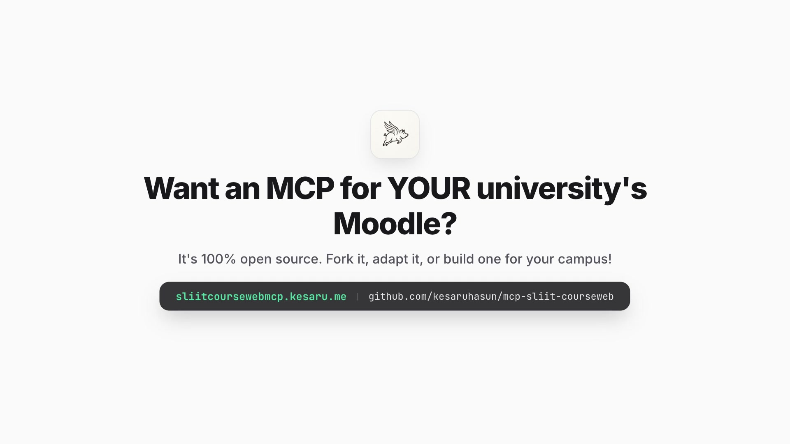
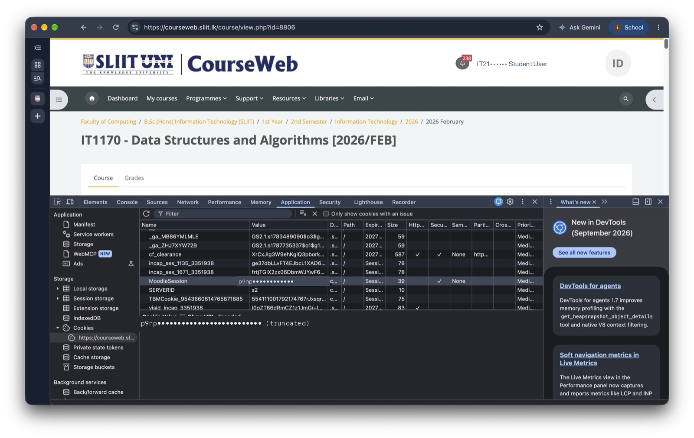
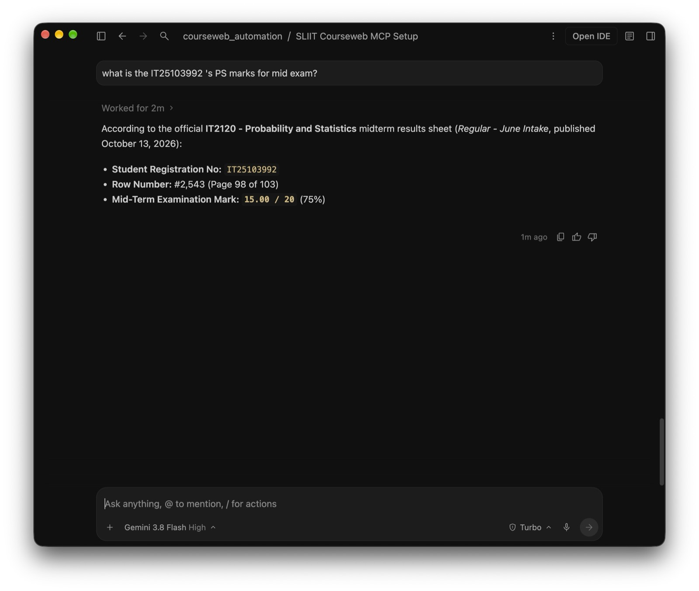
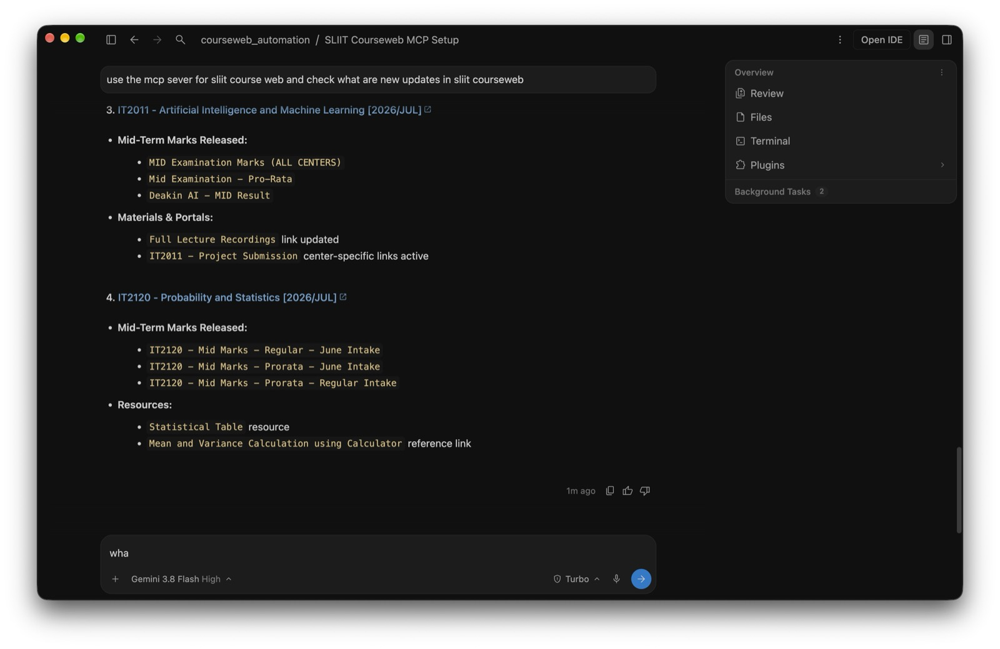

<div align="center">


# SLIIT Courseweb MCP Server 🚀

**Bridge SLIIT Courseweb (Moodle) into Claude Code, Cursor, Antigravity & AI Coding Assistants.**

[](https://modelcontextprotocol.io)
[](https://sliitcoursewebmcp.kesaru.me)
[](https://nodejs.org)
[](https://www.typescriptlang.org)
[](LICENSE)

<br/>

<p align="center">
  <a href="#-quick-video-showcase"><b>Watch Video</b></a> •
  <a href="#-1-prompt-agent-self-installation"><b>1-Prompt Install</b></a> •
  <a href="#-login-methods"><b>Login & MFA</b></a> •
  <a href="#-tool-reference"><b>Tools (9)</b></a> •
  <a href="#-student-superpowers"><b>Superpowers</b></a> •
  <a href="https://sliitcoursewebmcp.kesaru.me"><b>Live Website</b></a>
</p>

---

</div>

## 🎬 Quick Video Showcase

Watch Claude Code autonomously parse a **103-page PDF exam marksheet**, locate a student's grade breakdown, and delta-sync lecture slides without opening a single browser tab:

<div align="center">

<video src="assets/courseweb-launch-preview.mp4" poster="assets/courseweb-launch-poster.jpg" width="100%" controls playsinline>
  <a href="https://raw.githubusercontent.com/kesaruhasun/mcp-sliit-courseweb/main/assets/courseweb-launch-preview.mp4">
    
  </a>
</video>

<p align="center">
  <a href="https://raw.githubusercontent.com/kesaruhasun/mcp-sliit-courseweb/main/assets/courseweb-launch-preview.mp4">
    ▶️ <b>Watch 20-Second Launch Video (600 KB MP4)</b>
  </a> • 
  <a href="https://sliitcoursewebmcp.kesaru.me/#video-demo">
    🌐 <b>Stream in 1080p on Live Web Portal</b>
  </a>
</p>

<sub><em>Compressed 720p 60fps faststart preview (600 KB). Captured live running in Claude Code CLI.</em></sub>

</div>

---

## 💡 Why This Exists

SLIIT Courseweb is the central hub for lecture materials, lab sheets, and assignment submissions. But every semester, students face the same bottlenecks:

* ⏳ **Slow loading during peak hours**: Courseweb crawls right before assignment submission deadlines.
* 📑 **100+ Page Exam Marksheet PDFs**: Midterm and final marks are released as massive multi-page PDFs where finding your IT number is a chore.
* 📦 **Manual Download Fatigue**: Downloading 14 weeks of lecture slides, lab exercises, and tutorial answers requires clicking dozens of links.
* ⏰ **Missed Deadlines**: Assignment cutoffs are scattered across individual course tabs.

**The Solution:** An open-source **Model Context Protocol (MCP)** server that allows your AI agent (Claude Code, Cursor, Antigravity, Windsurf) to query Courseweb directly. Your agent acts as your personal academic assistant.

---

## ⚡ 1-Prompt Agent Self-Installation

You don't need to manually edit JSON configuration files. Just copy the prompt for your favorite AI assistant, paste it into the agent chat, and let the agent configure itself!

### 🟧 Claude Code CLI

```markdown
Please configure the SLIIT Courseweb MCP server for Claude Code CLI:
1. Run: git clone https://github.com/kesaruhasun/mcp-sliit-courseweb.git
2. Inside the folder run: npm install && npm run build
3. Add to Claude Code MCP registry:
   claude mcp add sliit_courseweb node "$(pwd)/build/index.js" -e HEADLESS=true
4. Run `claude mcp list` to verify the server is connected.
5. Remind me to perform `interactive_login` if my session token is expired.
```

### 🟦 Google Antigravity

```markdown
Antigravity, please self-configure the SLIIT Courseweb MCP server:
1. Clone `https://github.com/kesaruhasun/mcp-sliit-courseweb.git` or inspect the local repo.
2. Run `npm install` and compile TypeScript using `npm run build`.
3. Add the `sliit_courseweb` definition into your MCP configuration (`mcp_config.json`) pointing `command` to `node` and `args` to the absolute path of `build/index.js`.
4. Confirm tool schema registration for `list_modules`, `sync_module`, and `get_deadlines`.
5. Guide me on running `interactive_login` or injecting `MoodleSession` via `set_session_cookie`.
```

### ⬛ Cursor Composer / IDE

```markdown
You are my Cursor coding agent. Please install and self-configure the SLIIT Courseweb MCP server in this workspace:
1. Verify if git, node (v18+), and npm are installed.
2. Clone `https://github.com/kesaruhasun/mcp-sliit-courseweb.git`.
3. Inside the cloned directory, run `npm install && npm run build`.
4. Configure `.cursor/mcp.json` in workspace root:
   {
     "mcpServers": {
       "sliit_courseweb": {
         "command": "node",
         "args": ["<ABSOLUTE_PATH_TO_BUILD_INDEX_JS>"],
         "env": {
           "SLIIT_USERNAME": "your_it_number",
           "SLIIT_PASSWORD": "your_password",
           "HEADLESS": "true"
         }
       }
     }
   }
5. Check if `storage_state.json` exists. If not, guide me to run `interactive_login` or set my cookie via `set_session_cookie`.
```

### 🟩 Windsurf Cascade

```markdown
Cascade, please install the SLIIT Courseweb MCP server for this session:
1. Clone `https://github.com/kesaruhasun/mcp-sliit-courseweb.git` and compile: `npm install && npm run build`.
2. Add the configuration to `~/.codeium/windsurf/mcp_config.json`:
   {
     "mcpServers": {
       "sliit_courseweb": {
         "command": "node",
         "args": ["<ABSOLUTE_PATH_TO_BUILD_INDEX_JS>"],
         "env": { "HEADLESS": "true" }
       }
     }
   }
3. Restart your MCP connection and test by running `get_deadlines`.
```

### 🟪 Claude Desktop

Add this snippet to your `claude_desktop_config.json` (`~/Library/Application Support/Claude/claude_desktop_config.json` on macOS or `%APPDATA%\Claude\claude_desktop_config.json` on Windows):

```json
{
  "mcpServers": {
    "sliit_courseweb": {
      "command": "node",
      "args": ["/ABSOLUTE/PATH/TO/mcp-sliit-courseweb/build/index.js"],
      "env": {
        "SLIIT_USERNAME": "ITxxxxxxxx",
        "SLIIT_PASSWORD": "your_password",
        "HEADLESS": "true"
      }
    }
  }
}
```

---

## 🔐 Login Methods

Courseweb is protected by SLIIT's Microsoft Office 365 Single Sign-On (SSO) and Multi-Factor Authentication (MFA). This MCP server supports two seamless login strategies:

### Method 1: Interactive Browser Login (Recommended for Local Machines)

Ideal for macOS, Windows, or Linux with a desktop GUI:

1. In your agent chat, run the `interactive_login` tool:
   ```
   "Run interactive_login to sign into Courseweb."
   ```
2. A Playwright Chromium browser window pops up, navigates to `courseweb.sliit.lk`, and automatically fills your email and password.
3. Complete the Microsoft Authenticator 2-digit number match on your phone.
4. Once authenticated, the browser captures your session and securely persists cookies to `storage_state.json`. All future requests run 100% headlessly in the background!

### Method 2: Session ID / Cookie Injection (Headless Cloud & VMs)

Ideal for headless Linux servers, GitHub Codespaces, or remote VMs where opening a browser window is not possible:

<div align="center">
  
</div>

1. Open your laptop browser, navigate to [courseweb.sliit.lk](https://courseweb.sliit.lk), and log in.
2. Press `F12` (or `Cmd + Option + I`) to open **Developer Tools** → **Console**.
3. Paste this one-liner and press Enter to copy your active session cookie:
   ```javascript
   copy(document.cookie.split('; ').find(row => row.startsWith('MoodleSession=')).split('=')[1])
   ```
4. Tell your AI assistant:
   ```
   "Use set_session_cookie with this value: <PASTE_COOKIE_HERE>"
   ```
5. You're immediately logged in without any browser UI!

---

## 🛠️ Complete MCP Tool Reference

This server provides **9 specialized tools** exposed via the Model Context Protocol:

| Tool | Purpose | Key Parameters | Example Prompt |
| :--- | :--- | :--- | :--- |
| `list_modules` | Lists all enrolled modules, codes, and Moodle course IDs | *None* | *"What modules am I registered for this semester?"* |
| `get_deadlines` | Scrapes upcoming assignment submission deadlines and calendar events | *None* | *"What assignments are due in the next 7 days?"* |
| `get_announcements` | Fetches course notices, exam schedules, and lecturer broadcasts | `courseId` *(optional)* | *"Did the Distributed Systems lecturer post any exam notices?"* |
| `check_module_updates` | Detects newly posted files or modified sections in a course | `courseId` | *"Check if any new tutorial answers were uploaded to Software Architecture."* |
| `sync_module` | Delta-downloads all slides, lab sheets, and materials (MD5 hashed) | `courseId`, `outputDir` | *"Download all slides from Computer Networks to ./slides/networks."* |
| `download_file` | Downloads a specific file or syllabus document directly | `url`, `outputPath` | *"Download the lecture 4 PDF from this URL."* |
| `check_assignment_status` | Inspects submission status, grading grade, and marker comments | `assignmentId` | *"Did my SE4020 assignment 1 get graded yet?"* |
| `scrape_page` | Scrapes any Courseweb URL into clean, LLM-ready markdown | `url` | *"Scrape the main page for module 14202 and summarize the syllabus."* |
| `interactive_login` | Launches Playwright browser for Microsoft SSO & MFA approval | *None* | *"Run interactive login."* |
| `set_session_cookie` | Manually injects `MoodleSession` cookie for headless environments | `cookie` | *"Set Moodle session cookie to 9a8b7c6d5e4f..."* |

---

## 🌟 Student Superpowers

### Superpower 1: 103-Page Exam Marksheet PDF Search
Instead of waiting 5 minutes for a 20MB PDF to render in your browser and searching line by line, let your agent download and parse it:

<div align="center">
  
</div>

> **Prompt:** *"Check Courseweb for the Software Engineering Midterm marks PDF. Download it and find the score for IT21000000. Give me my class percentile and average."*

### Superpower 2: Intelligent Delta File Syncing
Never download duplicate files again. `sync_module` computes MD5 checksums for every file, creating local mirrors and downloading only fresh slides:

<div align="center">
  
</div>

> **Prompt:** *"Sync all lecture materials for Machine Learning to ./ML_Lectures. Only download newly uploaded slides."*

### Superpower 3: Autonomous Weekly Academic Standup
> **Prompt:** *"List all assignments due across all my modules this Sunday. Generate a priority to-do list with time estimates."*

---

## ⚙️ Manual Build & Development

If you prefer building and running from source manually:

```bash
# 1. Clone repository
git clone https://github.com/kesaruhasun/mcp-sliit-courseweb.git
cd mcp-sliit-courseweb

# 2. Install dependencies
npm install

# 3. Compile TypeScript
npm run build

# 4. Configure environment
cp .env.example .env
# Edit .env with your SLIIT credentials:
# SLIIT_USERNAME=ITxxxxxxxx
# SLIIT_PASSWORD=your_password
# HEADLESS=true

# 5. Start MCP Server (stdio mode)
node build/index.js
```

---

## 🌐 Live Landing Page & Multilingual Support

Check out the interactive web portal at **[https://sliitcoursewebmcp.kesaru.me](https://sliitcoursewebmcp.kesaru.me)**.

* 🇱🇰 **Spoken Sinhala (සිංහල)**: Explains MCP and Courseweb automation in casual student terms with Apple SF-style Sinhala typography (`Gemunu Libre` / `Sinhala MN`).
* 🇱🇰 **Spoken Tamil (தமிழ்)**: Native Sri Lankan Tamil explanations for students across all campuses.
* ⚡ **Interactive Prompt Builder**: Instant copy-paste blocks for Claude, Antigravity, Cursor, and Windsurf.
* 🎥 **Live Video Player**: Stream the 60fps launch showcase directly in your browser.

---

## 🛡️ Fair Use & Institutional Disclaimer

* This project is an independent open-source utility developed for personal educational efficiency and is **not officially affiliated with or endorsed by SLIIT**.
* The server uses polite request throttling and intelligent MD5 caching to avoid generating unnecessary server load on campus infrastructure.
* Users are responsible for keeping their institutional credentials secure and complying with campus IT acceptable use policies.

---

## 👨‍💻 Author & Contributions

Built with ❤️ by **[Kesaru Hasun](https://kesaru.me)**.

* 🌐 Portfolio & Blog: [kesaru.me](https://kesaru.me)
* 🐙 GitHub: [@kesaruhasun](https://github.com/kesaruhasun)
* 💬 Questions or bug reports? Open an [Issue](https://github.com/kesaruhasun/mcp-sliit-courseweb/issues) or submit a Pull Request!

---

<div align="center">
<sub>Powered by Model Context Protocol • Made for SLIIT Students</sub>
</div>
