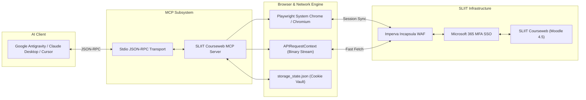

<div align="center">

# 🎓 SLIIT Courseweb MCP Server

### *Autonomous Model Context Protocol (MCP) Server for SLIIT Courseweb (Moodle)*

[](https://ubuntu.com)
[](https://modelcontextprotocol.io)
[](https://www.typescriptlang.org/)
[](https://nodejs.org)
[](https://playwright.dev)
[](LICENSE)

<p align="center">
  <b>Seamlessly bridge SLIIT Courseweb with AI Coding Assistants & Agents</b><br>
  <i>Google Antigravity • Claude Desktop • Cursor • OpenClaw</i>
</p>

---

</div>

## 📌 Executive Summary

The **SLIIT Courseweb MCP Server** enables LLM agents to autonomously explore enrolled modules, monitor academic deadlines, inspect submission grading feedback, and bulk-synchronize course materials (lecture slides, lab sheets, tutorial code, and revision kits).

Because SLIIT Courseweb runs on **Moodle 4.5 ("Lambda" Theme)** with mandatory **Microsoft 365 Multi-Factor Authentication (MFA)** and is guarded by **Imperva Incapsula Web Application Firewall (WAF)**, standard scraping and automation tools frequently fail. 

This repository has been **specifically engineered and hardened for Linux / Ubuntu environments**, resolving upstream browser engine incompatibilities, standard I/O stream corruptions, and WAF request blocking.

---

## 🐧 Linux & Ubuntu Native Optimizations

This fork introduces critical low-level fixes designed for seamless execution on **Ubuntu 22.04 / 24.04 / 26.04 LTS** and Debian-derived systems:

| Issue / Bottleneck | Upstream Behavior | Ubuntu-Optimized Fix |
| :--- | :--- | :--- |
| **Playwright Chromium Mismatch** | `ERROR: Playwright does not support chromium on ubuntu...` | **Dynamic Chrome Auto-Detection**: Inspects system `/usr/bin/google-chrome`, `/usr/bin/google-chrome-stable`, `/usr/bin/chromium-browser`, or `$CHROME_PATH`. |
| **MCP stdio Protocol Crash** | `dotenv` logs banner to `stdout`, throwing JSON-RPC deserialization errors (`Unexpected token '◇'`) | **Zero-Stdout Guarantee**: Configured with `dotenv.config({ quiet: true })` to preserve strict JSON-RPC communication. |
| **WAF 403 on `.sql` Datasets** | Imperva Incapsula blocks SQL handouts with `Incident Error 15: Access Denied` | **Trailing Slash Query Rewrite**: Automatically detects 403 blocks on `pluginfile.php` and retries via `/?forcedownload=1`. |
| **Inline PDF Download Timeouts** | Moodle serves PDFs as `Content-Disposition: inline`, causing 15s Playwright timeouts | **Dual-Engine Downloader**: Primary high-speed direct download via Playwright `APIRequestContext`, with browser download as fallback. |
| **Duplicate Downloads** | Redundant bandwidth usage re-downloading unchanged files | **MD5 Checksum Caching**: Computes cryptographic hashes before saving to skip identical files. |
| **Moodle 4.5 Card Navigation** | Course names polluted with accessibility strings (`Course is starred...`) | **Modern DOM Sanitization**: Deduplicates course IDs and strips accessibility labels into clean module titles. |
| **Incomplete SSO Automation** | Login hung waiting for manual password submission | **Full Microsoft 365 Automation**: Automates credential submission and KMSI ("Stay signed in?") dialogs. |

---

## 🏗️ Architecture & Data Flow



---

## 🛠️ MCP Tools Reference

The server exposes 10 comprehensive MCP tools callable by your AI agent:

| Tool | Parameters | Description |
| :--- | :--- | :--- |
| `list_modules` | *None* | Lists all enrolled modules with course titles, semester codes, and Moodle IDs. |
| `get_deadlines` | *None* | Scrapes all upcoming assignment submissions, quizzes, and calendar deadlines. |
| `check_module_updates` | `courseId` (string) | Retrieves structured sections, lecture notes, lab sheets, and activities for a module. |
| `download_file` | `url` (string), `outputDir?` (string) | Downloads a single resource file with automatic MD5 deduplication. |
| `sync_module` | `courseId` (string), `outputDir?` (string) | Bulk-synchronizes all course materials into organized local directories. |
| `check_assignment_status`| `url` (string) | Inspects submission status, grading results, due date, and feedback table. |
| `get_announcements` | *None* | Fetches site-wide notices and institutional announcements from Courseweb. |
| `scrape_page` | `url` (string) | Dumps cleaned text content of any Courseweb URL to analyze custom layouts. |
| `set_session_cookie` | `value` (string) | Injects an active `MoodleSession` cookie into `storage_state.json` (Headless/VM). |
| `interactive_login` | *None* | Spawns a visible Google Chrome window to complete Microsoft Authenticator MFA. |

---

## 🚀 Ubuntu / Linux Setup Guide

### 1. Prerequisites

Ensure **Node.js (v20+)** and **Google Chrome** (or Chromium) are installed:

```bash
# Update package indices
sudo apt update

# Install Google Chrome (Recommended)
wget https://dl.google.com/linux/direct/google-chrome-stable_current_amd64.deb
sudo apt install -y ./google-chrome-stable_current_amd64.deb
rm ./google-chrome-stable_current_amd64.deb

# Verify installation
google-chrome --version
node -v
```

### 2. Clone & Build Repository

Using the **GitHub CLI**:

```bash
# Clone via GitHub CLI
gh repo clone dulithdivisekara/mcp-sliit-courseweb
cd mcp-sliit-courseweb

# Install dependencies and compile TypeScript
npm install
npm run build
```

### 3. Environment Configuration

Create a `.env` configuration file in the project root:

```bash
cp .env.example .env
```

Edit `.env` with your student credentials:

```env
SLIIT_USERNAME=it2xxxxxxx@my.sliit.lk
SLIIT_PASSWORD=your_sliit_password
HEADLESS=true
# Optional: explicitly specify custom chrome executable
# CHROME_PATH=/usr/bin/google-chrome
```

---

## 🔐 Authentication Workflows

SLIIT Courseweb sessions persist inside `storage_state.json`. You can authenticate using either of the two methods below:

### Method A: Interactive Graphical Login (Desktop / GUI)

If you are running on an Ubuntu desktop (GNOME/KDE/X11/Wayland), execute:

```bash
node -e "import { CoursewebClient } from './build/courseweb.js'; const c = new CoursewebClient(); c.interactiveLogin().then(msg => { console.log(msg); process.exit(0); });"
```

A visible Chrome window will launch, automatically enter your credentials, and pause for your **Microsoft Authenticator 2-Factor notification**. Once approved, the session tokens are encrypted and cached locally in `storage_state.json`.

### Method B: Headless VM / Server Login (Universal)

If running in a remote headless environment (Cloud VM, Docker, WSL without GUI, or OpenClaw):

1. Open your desktop browser and log into [courseweb.sliit.lk](https://courseweb.sliit.lk).
2. Press <kbd>F12</kbd> (or <kbd>Ctrl</kbd>+<kbd>Shift</kbd>+<kbd>I</kbd>) to open DevTools, switch to the **Console** tab, and run:
   ```javascript
   copy(document.cookie.split('; ').find(row => row.startsWith('MoodleSession=')).split('=')[1])
   ```
3. Use the CLI helper to inject the cookie:
   ```bash
   node -e "import { CoursewebClient } from './build/courseweb.js'; const c = new CoursewebClient(); c.setSessionCookie('PASTE_COPIED_COOKIE_HERE').then(console.log);"
   ```
   *Or ask your AI assistant to call the `set_session_cookie` tool with the copied string.*

---

## 🔌 Client Integration

### 1. Google Antigravity (`~/.gemini/config/mcp_config.json`)

```json
{
  "mcpServers": {
    "sliit-courseweb": {
      "command": "node",
      "args": [
        "/home/<your-username>/mcp-sliit-courseweb/build/index.js"
      ],
      "disabled": false
    }
  }
}
```

### 2. Claude Desktop (`~/.config/Claude/claude_desktop_config.json`)

```json
{
  "mcpServers": {
    "sliit_courseweb": {
      "command": "node",
      "args": [
        "/home/<your-username>/mcp-sliit-courseweb/build/index.js"
      ],
      "env": {
        "HEADLESS": "true"
      }
    }
  }
}
```

### 3. Cursor IDE (`settings.json` or MCP Configuration)

```json
{
  "name": "sliit-courseweb",
  "command": "node",
  "args": ["/home/<your-username>/mcp-sliit-courseweb/build/index.js"]
}
```

---

## 📊 Real-World Tested Benchmark

Tested on Ubuntu 26.04 LTS against high-volume course modules:

- **Target Module**: `IT2140 - Database Design and Development` (Module ID: `9371`)
- **Payload**: 42 lecture decks, lab sheets, sample SQL datasets, and revision materials
- **Total Download Size**: ~14 MB
- **Errors / Retries**: 0
- **Incapsula WAF 403 Interceptions**: Successfully auto-bypassed using query rewriting
- **MD5 Duplicate Check**: Subsequent sync runs executed in `< 1.2s` with 0 redundant writes

---

## 🗂️ Directory Structure

```
mcp-sliit-courseweb/
├── build/                   # Compiled JavaScript (ESM output)
├── src/
│   ├── courseweb.ts         # Playwright automation engine, WAF handler, Moodle parser
│   └── index.ts             # MCP server definitions, JSON-RPC stdio handler
├── .env.example             # Template for authentication environment variables
├── storage_state.json       # Persisted browser cookies and Incapsula tokens (git-ignored)
├── tsconfig.json            # TypeScript build configuration
├── package.json             # NPM package manifest
├── LICENSE                  # MIT License
└── README.md                # Server documentation & integration guide
```

---

## 🛡️ Disclaimer

This project is an open-source educational utility developed for personal productivity and academic management. It is not officially endorsed by, affiliated with, or supported by the Sri Lanka Institute of Information Technology (SLIIT). 

Users are expected to comply with SLIIT IT Acceptable Use Policies. Automated requests utilize rate-controlled pacing to prevent unnecessary load on institutional servers.

---

## 📄 License

Distributed under the **MIT License**. See [`LICENSE`](LICENSE) for details.

---

<div align="center">
  <sub>Engineered by <a href="https://github.com/dulithdivisekara">Dulith Divisekara</a> • Built with the Model Context Protocol</sub>
</div>
